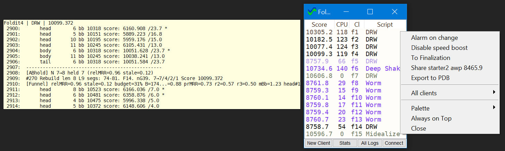
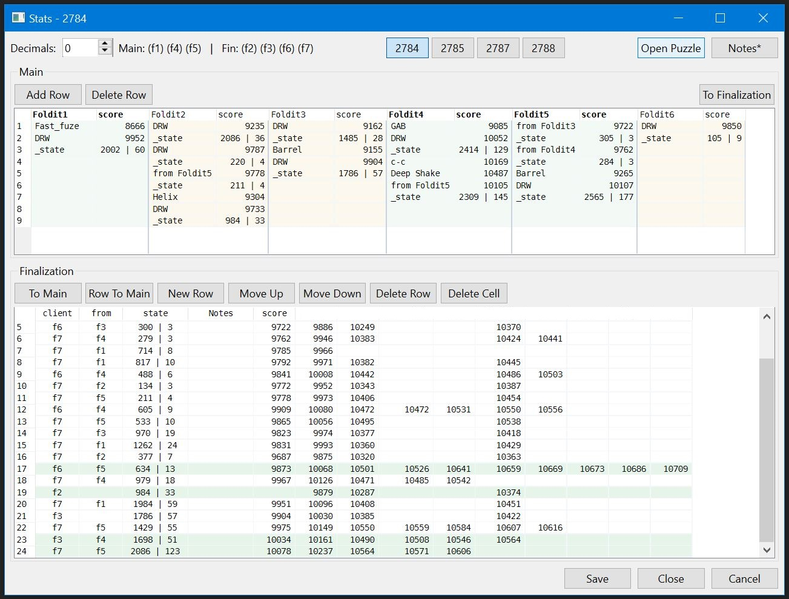
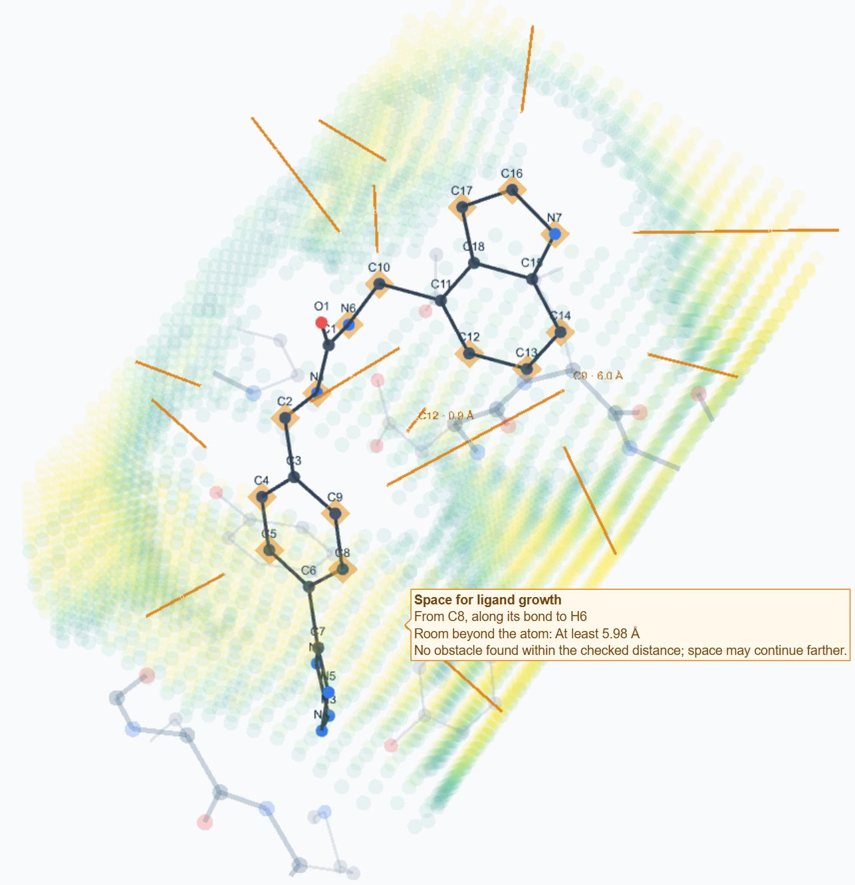

# Foldit Monitor

Foldit Monitor is a desktop helper for watching local Foldit clients, tracking scores and logs, viewing puzzle statistics, and connecting monitors over a local network.

[](docs/images/main-window.png)

[](docs/images/stats-window.jpg)


## Install and run

You need at least one local Foldit client and Python 3.11-3.13. Python 3.13
is recommended. Running the Python version is recommended: it is easier to
update and shows useful error messages if something needs attention.

1. Install [Python](https://www.python.org/downloads/).
2. Download this repository with **Code → Download ZIP**, then extract the archive.
3. Open a terminal in the extracted project folder and install the packages:

   ```bash
   python -m pip install -r requirements.txt
   ```

4. Start the monitor:

   ```bash
   python "Foldit Monitor.pyw"
   ```

### Alternative: Windows EXE

If you do not want to install Python, open [the latest release](https://github.com/sercatp/FolditMonitor/releases/latest), download `FolditMonitor-windows-x64.zip`, extract the entire ZIP, and run `FolditMonitor.exe`. The ZIP already includes everything required.

## Platform notes

`requirements.txt` installs the appropriate Python window-integration package for the current operating system.

- **Windows:** fully supported. The Python installation receives `pywin32` and the shortcut helper; the ZIP release is also available for Windows x64.
- **Linux:** install the system Tk package as well as the Python requirements (for example, `python3-tk` on Debian/Ubuntu). Client-window detection and activation require an X11 session or XWayland; a pure Wayland session is not supported by the current window manager.
- **macOS:** install a Python build with Tk support; the requirements install
  the Cocoa and Quartz bridges automatically. Client-window integration remains
  experimental and there is no packaged macOS release. See the complete
  [macOS setup and multi-Track notes](docs/README-macOS.md).

## First launch

Foldit Monitor starts with the bundled [default profile](modules/resources/Foldit%20Monitor.defaults.json), then creates a separate local `data/Foldit Monitor.json`. That local file keeps window positions, paths, last-used puzzle data, and connections; it is intentionally not part of the repository.

Right-click the main window and choose **Settings…** to edit the local settings. The dialog validates changes before saving them; some settings take effect after a restart.

Local settings, puzzle statistics, cached saves, and ligand reports live in `data/`. Existing settings, `puzzle_logs/`, `ligand_viewer_reports/`, and diagnostic `logs/` from the old layout are moved there automatically on startup. Save backups beside Foldit installations keep their existing location. Back up `data/` separately from the source code.

## Project folders

- `Foldit Monitor.pyw` — start the application; no other Python file needs to be launched.
- `modules/` — application implementation.
- `modules/resources/` — public defaults and the bundled alert sound.
- `data/` — local settings, puzzle logs, cached saves, reports, and diagnostics; excluded from Git.
- `tests/` — automated tests (`python -m unittest discover -s tests -q`).
- `docs/` — platform instructions and screenshots.
- `tools/` — optional build and source-backup utilities.

The folder layout and local data are described in
[Project structure](docs/PROJECT_STRUCTURE.md).

Relative puzzle-log folders in settings are resolved inside `data/`. Absolute paths
remain absolute. Legacy custom relative paths retain their previous locations
during the automatic migration.

## Save Manager

Save Manager shows saves for the selected puzzle across Foldit clients. It checks
cached puzzle mappings against local `.ir_puzzle` files when those files are
available. The Mode, Player ID, Source base, and Base gain columns use metadata
found in the save file's PDLT block; unknown modes are left blank.
Available metadata stays visible even if another field cannot be read. The
standalone [save-file API](docs/savefile_api.md) also returns partial results.

You can filter the list, select several visible saves with the platform's normal
multi-selection keys, or use **Select All**. **Copy to…** accepts one or more
clients and an existing external folder. **Share to all** copies to running
clients, and **Export PDB** handles the full selection. **Delete** permanently
removes selected save files after a confirmation and skips files that changed
since the list was refreshed.

Speed Boost is disabled by default. To expose its menu, set
`speed_boost.enabled` to `true` in the generated `data/Foldit Monitor.json` and
restart the monitor. The same section contains the configured return-address
`offsets`; invalid or empty lists keep the feature disabled.

## Ligand Viewer

Ligand Viewer displays ligands from Foldit saves in an interactive 3D view and provides a brief analysis of their surroundings.

[Ligand Example](https://sercatp.github.io/FolditMonitor/) — explore an interactive 3D report in your browser.



## Possible issues

### No alert sound on Python 3.14

Foldit Monitor can notify you about events with a sound. Python 3.14 is outside
the supported range, and pygame currently has no macOS package for that Python
version. `requirements.txt` therefore skips pygame automatically on Python
3.14. The monitor can still run, but sound alerts are unavailable; use Python
3.13 for full functionality.

### One installation with multiple Tracks

Several Foldit processes can use different Tracks from the same installation.
Foldit Monitor normally detects this automatically by inspecting which
`scriptlog.<track>.xml` file each process has open.

If a log remains unidentified, add a fallback to the existing
`data/Foldit Monitor.json` file:

```json
{
  "monitoring": {
    "log_fallbacks": [
      {
        "log_path": "/Applications/Foldit.app/Contents/Resources/scriptlog.Solo1.xml",
        "name": "Foldit Solo1",
        "title_suffix": " - Solo1",
        "puzzle_id": "2802"
      }
    ]
  }
}
```

Only `log_path` is required. The other fields improve display names, PID
matching, and statistics. If the configured log cannot be associated with a
PID, it still appears as a logical client without CPU and window actions.
